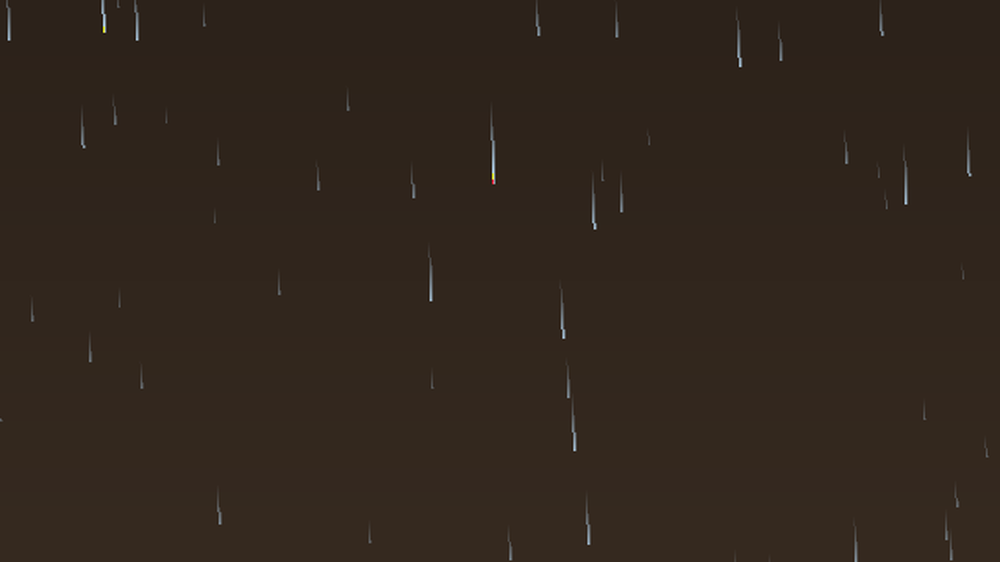
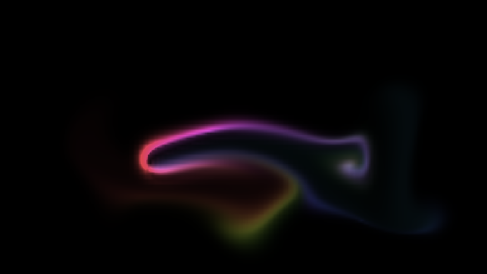
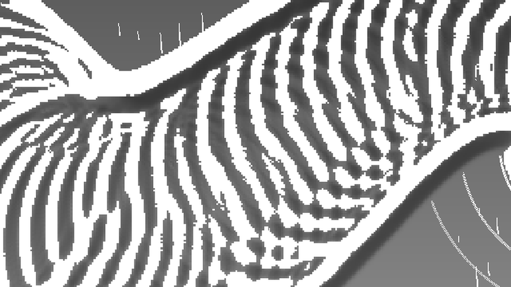
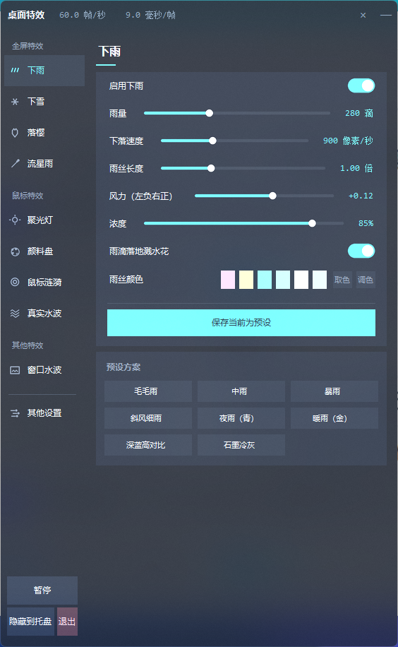
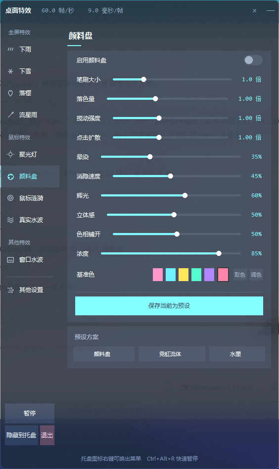
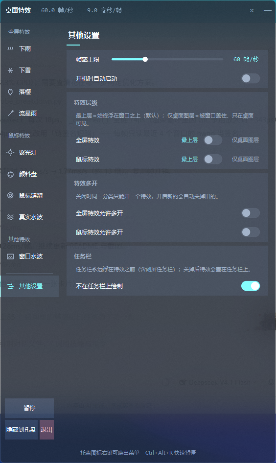

# 桌面特效（DesktopFX）

一个纯 Python 的 Windows 桌面特效程序：覆盖全桌面（含多显示器）的**下雨 / 下雪 / 落樱 / 流星雨 / 颜料盘 / 真实水波 / 聚光灯 / 窗口水波**等多种粒子与氛围特效，鼠标移动 / 点击时在光标位置生成涟漪。

特效按驱动方式分成**三类**，侧栏即按此分组：

| 分类 | 特效 | 渲染层 |
| :--- | :--- | :--- |
| **全屏特效** | 下雨 / 下雪 / 落樱 / 流星雨 | 全屏层 |
| **鼠标特效** | 聚光灯 / 颜料盘 / 鼠标涟漪 / 真实水波 | 鼠标层 |
| **其他特效** | 窗口水波 | 鼠标层 |

两类图层**各有独立的显示层级**（最上层 / 仅桌面图层）与**独立的多开开关**，都在「其他设置」页里调。**所有参数实时可调，支持保存为自定义预设方案并随时删除**，配置自动持久化。


## 效果一览

- **下雨**：3 层景深（远 / 中 / 近），自带风偏、长度 / 浓度 / 速度 / 落点溅水花调节
- **鼠标涟漪**：跟随鼠标移动 / 点击触发，多层同心圆环 + 真实 alpha 衰减
- **真实水波**：**二维波动方程**（高度场 + 速度场双缓冲）驱动的真水面。波会向外传播、相互干涉、撞到屏幕边缘反射，一次点击的涟漪要好几秒才传遍屏幕、二十多秒才平复。参考壁纸是 jQuery Ripples —— 它用 WebGL 采样背景图做**折射**；透明覆盖层拿不到桌面像素（`WaveField` 就是因此删掉的），所以改成把波面坡度当法线、按固定光向做**迎光提亮 / 背光压暗**加浪尖高光，对任何桌面底色都成立。
  上屏走**双线性显示网格**（模拟格 3.4px -> 显示格 1.7px），否则每个格子就是一块硬方块（"方格纸"）。
  它是叠在桌面上的半透明明暗条纹，**浓度（`wave_opacity`）有 20% 的硬上限**
  （面板滑块也卡在这个上限）—— 浓度就是"桌面被盖住多少"。默认档取 14%（alpha 峰 31 / 均 6），
  预设里有五档可从"几乎看不见"调到"上限"，直接对比哪种干扰程度能接受
- **聚光灯**：全屏压暗 + 鼠标处一个柔边透明圆洞，凸显光标周围；压暗只做整块内存赋值，圆洞仅在光标周围包围盒内逐像素计算，远处屏幕不会被逐像素扫描
- **窗口水波**：把桌面上的窗口当成**水面上的活塞** —— 它自己不画一个像素，只往**与「真实水波」共用的那片水面**上注入位移，于是移动 / 缩放 / 最小化 / 恢复都是**真实扰动水面**：**移动**时前缘推水、后缘留下空腔（船首浪 + 船尾迹）；**拉宽**是水被推开、**缩窄**是水合拢回来；**最小化**是水从四周合拢填掉窗口占的位置、**恢复**是重新把水压开。平移与改尺寸走的是**同一个式子**（四条边各按**自身法向速度**注入 `v·n`），静止的窗口**绝对零注入** —— 泡着不动的石头不搅水。
  波只朝窗外走，为此做了三层：扰动带**只铺窗外一侧**、包**两端归零**（只铺外侧还不够 —— 包若在窗缘处直接取峰值，那里就是一个空间跳变，它自己会向内辐射一片波，实测窗内漏量比窗外还大）、并且连**速度场**一起写成**一列朝外走的行波**（静止的位移包在波动方程里必然一分为二，另一半照样往窗口里钻）。三层齐全后窗内漏量 128% → **8.5%**，而窗外波高与旧写法实测比 **0.94**，手感不变。
  因为共用一片水，波速 / 余波 / 光照 / 浓度统一在「真实水波」页设置，本页只有**扰动强度**与**扰动范围**两个旋钮
- **下雪**：按深度分 3 档近大远小（远→近依次盖章，近雪压住远雪 = 画家算法），逐粒子亮度脉动（刻意只做变暗，峰值不衰减）、近雪辉光（复合核一次盖完，不留暗环）、独立风速 + 双正弦阵风（与按深度放大的透视倾斜解耦）
- **落樱**：花瓣按「主体 → 边缘泛白」双色渐变，带自旋与翻面（翻到侧立时面积收到最扁、颜色偏白），逐片独立相位摆动 + 整场均匀风速与阵风
- **流星雨**：斜向高速掠过的彗星（想定取自 Wallpaper Engine「流星夜」）。轨迹不是栅格化线段，而是**按间距采样成一串同半径圆盘**一次性向量化盖章；圆盘核内留一段**平坦区**，否则相邻圆盘的中点亮度只有一半、彗尾会串成珠子。头部 additive 白点 + 头部辉光（烘进同一张复合核），可叠加一层星空。**燃尽距离由屏幕几何决定**：从出生点沿飞行方向一路飞到背风边再燃尽，并且允许飞过屏边一点（`_BURN_MAX = 1.35`）—— 因为生灭包络在最后 30% 寿命里渐隐，行程若"正好到屏边"，流星在离屏边还有三成路程时就淡没了，底部照样是空的。早期版本按「尾长 × 1.3~2.3」这个**与屏幕无关**的固定长度飞，屏幕一高就够不着底：1920×1200 下顶部 20% 的密度是底部 20% 的 5.7 倍、3840×1200 下 15 倍，看着就是"只有上半屏有流星"
- **颜料盘**：**鼠标搅动的流体颜料**（参考 WebGL Fluid Simulation）。指针滑过的轨迹被采样成一串落色点并沿运动方向给流场一记冲量 —— 颜料被拖出去、再被 curl-noise 基流卷成涡、拉成丝；**点击**在落点撒一圈径向向外的冲量，颜料像掉进水里一样炸开扩散；推流强度按**指针速度**给（`_FOLLOW`），所以拖拽时颜料的亮部就压在鼠标底下、拖尾只是身后一层慢慢散掉的余韵；**停手后**颜料继续涡旋、逐渐消隐，屏幕重新变干净（不喂指针时一个像素都不画）。色相由一个**连续推进的相位**驱动（时间 + 指针行程），一笔拖过去就是一条色相渐变的彩带，而不是每帧掷一次随机色（那样相邻帧的互补色叠加会互相抵消，整片变灰白噪声）。半拉格朗日平流 + 预烘基流，**不做 GPU 那套 20 次 Jacobi 压力投影**：由「∂φ/∂y, −∂φ/∂x」构造天然无散度的基流，每帧只做一次 3 条基流的时间加权混合（0.2ms）。**上屏前先把模拟网格双线性放大到"显示网格"**：模拟网格短边只有 ~110（格子 ~10px），直接最近邻铺屏就是满屏方格纸（参考实例的染料纹理是 1024 宽才那么丝滑，CPU 上把模拟网格提到那个量级要 20 倍平流开销）；插值后格边长降到 ~3.3px 且完全没有硬边
- **零侵入**：覆盖层是 `WS_EX_LAYERED | WS_EX_TRANSPARENT` 置顶窗，鼠标事件完全穿透，不会拦截任何点击
- **双图层 + 可切层级**：全屏特效与鼠标特效分别画在**两个独立的覆盖窗口**上，因此可以各自设定显示层级 —— **最上层**（默认，浮在所有窗口之上）或**仅桌面图层**（`SetParent` 挂到桌面壁纸层 WorkerW，被任何窗口盖住，像壁纸的一部分）。挂桌面层时会先把 `WS_POPUP` 改成 `WS_CHILD` 建立真正的父子关系（只调 `SetParent` 对 popup 窗无效），并校验 WorkerW 覆盖整个虚拟屏幕（多显示器 / 壁纸轮播程序未就绪时回退成"压到 z 序最底"）；资源管理器重启导致 WorkerW 销毁时按秒自检重建
- **上屏的 pptDst 坐标系跟着窗口走**（`Overlay._origin`）：顶层窗用屏幕坐标，而 `WS_CHILD` 子窗口用的是**父窗口客户区坐标**。桌面层的窗口挂在 WorkerW 下，若 `present()` 仍传屏幕坐标 `self.x/self.y`，窗口会被再挪一个"父客户区原点"的距离，而且**每帧都挪**：在"副屏在主屏左侧"的常见布局里（虚拟屏原点 x = −1920），桌面层窗口稳定停在屏幕 `(-3840, 0)` —— 主屏上完全看不到桌面层特效，副屏位置也偏。所以挂载时用 `ClientToScreen` 把客户区原点记进 `_origin`，`present()` 统一减掉它；`_detach_parent` / 重建时归零。**子窗口相关的还有一条**：`_attach_desktop` 判断样式有没有改成功要**回读 `GWL_STYLE`**，不能看 `SetLastError` —— `SetWindowLong` 成功时并不保证清零 last error，而"样式本来就是 `WS_CHILD`"（重复施加层级时）不会触发任何内部动作，残留的旧错误码会被当成失败，于是明明挂得上却静默降级成"沉底窗口"
- **同类互斥 / 多开**：同类的特效默认**只留一个**（新开一个会自动关掉同类的另一个，比如开"下雪"会关掉"下雨"）；在「其他设置」里可分别把**全屏特效 / 鼠标特效**改成"允许多开"，就能雨雪同屏、聚光灯 + 水波一起上。互斥只在**开启动作**发生时触发，启动时不会偷偷改动你当前的桌面
- **置顶保活（每帧自检）**：**每帧**自检是否被第三方置顶窗（全屏视频 / 画中画 / 悬浮窗 / **Citrix 之类的远程桌面全屏窗**）盖住，**只在真被盖住时**才复位（仅作用于"最上层"的那一层；设成"仅桌面图层"的层本就该被盖住，不参与复位）。判据要求「可见 **且** 长宽 ≥ 32px **且** 类名不在 shell 黑名单」—— 只看 `IsWindowVisible` 会恒为真，因为 z 序链上常驻 IME / ForegroundStaging / 触摸板 SynTP / 缩略图 helper 等「可见但 0×0 或 1×1」的驱动辅助窗。每帧做这件事必须便宜，所以有两道闸门：**链签名短路**（只读我们之上最近 4 个窗口的 hwnd，实测 0.7µs/次；全量检查要读矩形 18µs + 类名 4.3µs 一次约 74µs）与**抢顶限流**（两次真复位至少隔 0.1s）。能盖住全屏覆盖窗的窗口必然被抬到 topmost 组顶部、必然改变签名，所以短路不会拖慢反应 —— 链一变当帧就重查
- **插入锚点不得自封顶**（`Overlay._anchor`）：复位时把窗口插到**控制面板正下方**（win32 里 `SetWindowPos(A, B)` 是把 A 插到 B **之下**），这样既复位又不遮住设置界面。**但前提是面板自己压得住那个对手**：面板的置顶保活是 1s 一次，而 Citrix 那类远控全屏窗会以十几 Hz 重新置顶自己，很容易把面板压到下面。那一刻再拿面板当锚点就成了**天花板** —— 每次"抢顶"都只是把覆盖层插回面板之下，永远回不到对手之上（合成窗口实测：同一进程只换锚点，被盖采样 **0% → 100%**，抢顶 78 次全部白费；且 20fps 与 60fps 结果相同 —— 瓶颈不是抢顶频率，是方向）。所以面板要同时满足两条才配当锚点：**它自己是置顶窗**（把置顶窗插到**非置顶窗**之后会把 `WS_EX_TOPMOST` 一起清掉，实测连抢 30 次也回不来）**且在对手之上**；否则直接插到置顶组顶部。另外置顶位若因故丢失，每帧自检会顺手补回来（读一次扩展样式 ~0.3µs）
- **避让任务栏**：覆盖窗是置顶窗、**任务栏不是**，所以不挡的话特效会被直接画在任务栏上（真实水波那种整片明暗条纹糊上去就是"残影"）。上屏前把每块屏的任务栏矩形（`Shell_TrayWnd` + 各副屏的 `Shell_SecondaryTrayWnd`）从两层缓冲里擦掉，任务栏于是永远干净 —— 观感上等于**任务栏浮在特效之前**。任务栏放上/下/左/右都成立，自动隐藏时系统把它挪到屏幕外、矩形自然不相交，不需要特判。可在「其他设置 → 任务栏」关掉
- **高 DPI 友好**：启动时声明 `DPI_AWARENESS_CONTEXT_PER_MONITOR_AWARE_V2`，在 Win10/11 125%/150% 缩放下覆盖层仍精确贴合物理像素
- **单实例**：进程互斥体保证只有一个实例在跑。重复双击不会叠出第二份雨，而是把已运行实例的面板叫出来

### 渲染预览

> 覆盖层本身是**全透明**的（只画特效像素，不画背景）。为了看清效果，下面这些单帧叠了一层
> 渐变底 —— 实际使用时它直接浮在你的桌面和窗口之上。
> 注意**真实水波那格垫的是中性灰**而不是深色：它同时做「迎光提亮」和「背光压暗」，
> 深底会把压暗的那一半吃掉。

| 下雨 | 下雪 |
| :---: | :---: |
|  |  |

| 落樱 | 流星雨 |
| :---: | :---: |
|  |  |

| 颜料盘（鼠标拖过的轨迹被搅成涡与丝） | 真实水波（迎光提亮 / 背光压暗） |
| :---: | :---: |
|  |  |

| 控制面板 |
| :---: |
|  |

实机渲染示例：3840×1200 虚拟屏上稳定 60 FPS，单帧渲染耗时 7-11 ms。最坏情况（暴雨 + 120 涟漪）88 FPS（用 `_verify_perf.py` 测得）。雨雪聚光灯同开（暴雨 620 + 暴雪 560 + 聚光灯）纯渲染 74-78 FPS（用 `_verify_perf_layers.py` 测得），**算上两个覆盖窗口的实际上屏**约 62 FPS（空层跳过已生效，长跑 3600 帧内存无增长、无 NaN）。

> 单层成本（`_verify_perf.py` 同类基准）：雪花 ≈ 5 ms/帧、流星雨 ≈ 5.4 ms/帧（1080p），**颜料盘最重**。
> **真实水波**是**第二重但也最可控**：它是交互特效且默认关闭，成本全随「还有波的包围盒」走 ——
> 不吃指针时整帧 ≈ 0（`draw` 直接空转，一步不推进、一个像素不写）；单次点击的 `draw` 只要 1~2 ms；
> 只有连续拖动把波铺满大半屏时才会到十几毫秒（`update` 约 1.2 ms/帧 + `draw` 满屏波约 9 ms @1080p）。
> 上屏做了两条优化：`dep → 预乘像素` 的**查表着色**（只依赖一个标量，预计算成 8192 级查找表，
> 运行时只剩量化 + 查表，结果与逐项公式**逐字节相同**）与**整片直写**（鼠标层这一帧只有水波时
> 缓冲区是空的，整片直写 1.0 ms 替代逐像素比掩码 7.0 ms）。4K 满屏波 33.6 ms → 18.7 ms。
> **窗口水波**与它共用同一片水，所以拖窗口时走的是同一条成本曲线。
> **颜料盘**同样默认关闭：拖一小笔约 1~2 ms，把整屏都涂满才退化到十几毫秒。两者都是 CPU 逐像素路线的天花板。

> **可见度自检**：默认色与所有预设都用 `_verify_visibility.py` 在白底 (255,255,255) 和深底 (24,28,36) 上量化评分，并设了 **50 分硬门槛** —— 任一底色上不达标，脚本直接以退出码 1 失败，而不是默默放行。当前默认值评分 **70 / 94**（满分 100），28 个预设全部达标，开箱即用不挑桌面底色。
>
> 这个门槛是必要的：早期版本默认色 `#BFE3FF` 在白底只有 28 分，等于隐形；"毛毛雨"预设更低到 36 分。两者都已调深，并由门槛守住防止回退。

## 下载

不想装 Python 的话，直接下载打包好的**单文件 exe**：

**[⬇ 下载 DesktopFX.exe（最新版）](https://github.com/jxust-CGS/DesktopFX/releases/latest)**

- **免安装**：放到任意**可写**目录（桌面、D 盘都行），双击即可。
  配置、自定义预设、界面状态都写在 exe 同目录 —— 换个目录就是一套全新配置，
  整个目录搬走设置也跟着走，卸载 = 删目录。
- **首次运行 Windows 可能弹 SmartScreen「已保护你的电脑」**：因为 exe 没有代码签名
  （签名证书要钱），点「更多信息」→「仍要运行」即可。
- 需要 **Windows 10 / 11 64 位**；不需要 Python、不需要联网。
- 想从源码跑（开发 / 改代码）见下一节。

## 快速开始

### 一键启动

双击 `启动桌面特效.bat`。启动器按优先级找 Python 和虚拟环境：

1. Python：环境变量 `DESKTOP_FX_PY` → 本机已知的安装路径 → `PATH` 里的 `python`
2. 虚拟环境：环境变量 `DESKTOP_FX_VENV` → 本机开发 venv → `%LOCALAPPDATA%\DesktopFX\venv`
3. 首次运行自动创建 venv，并通过清华镜像安装依赖 `numpy`（渲染）+ `Pillow`（界面抗锯齿）
4. 启动主程序 `desktop_fx.py`（依赖缺失或 venv 不存在时才需要联网，其余情况全离线）

> 界面抗锯齿（滑块 / 开关 / 图标）依赖 Pillow；装不上时程序会自动退回无抗锯齿的 Canvas 画法继续运行。

### 退出方式

- 托盘图标 → 右键 → 退出
- 控制面板顶栏的 × 按钮
- 任务管理器结束 `pythonw` 进程

> 程序只允许一个实例。再次双击启动器时，新的进程会把已运行实例的控制面板叫出来然后自己退出 —— 不会叠出第二层雨。

### 维护启动器

`启动桌面特效.bat` 有两个硬性要求，违反其中任何一条都会让它彻底打不开（症状是双击后一闪而过，或者报"系统找不到指定的批处理标签"）：

1. **必须是纯 ASCII**。cmd.exe 用系统 ANSI 代码页（中文 Windows 上是 GBK）读 `.bat`，UTF-8 中文会被拆成乱码并破坏引号配对。
2. **必须是 CRLF 换行**。只有 LF 时 `goto` 标签解析会失败。

启动器由 `_make_launcher.py` 生成（自动保证 CRLF + ASCII）；**不要直接改 .bat**，要改逻辑请改生成器再运行它：

```bash
python _make_launcher.py   # 重新生成 启动桌面特效.bat（CRLF + ASCII）
python _verify_launcher.py # 双击全链路验证（含路径存在性、goto 标签可达性）
```

另外：**不要用 Git Bash 写这个文件**。MSYS 会把"看起来像绝对路径"的内容里的反斜杠改成斜杠（`C:\Users\...` → `C://Users//...`）。

## 拷到其它电脑（分发）

整个 DesktopFX 目录拷到另一台 Windows 机器后**直接双击 bat 即可**，但目标机器要满足：

1. **Windows 10 / 11**（依赖 `user32` `gdi32` `shell32` 的 Win32 API，纯 Windows）
2. **已安装 Python 3.9+**（官方 python.org 安装包默认带 tkinter；安装时勾选 *Add python.exe to PATH*）
3. **首次运行需要联网一次**：自动创建 `%LOCALAPPDATA%\DesktopFX\venv` 并 pip 安装 `numpy + Pillow`；装完即离线可跑

说明：

- **不要拷 venv**（Windows venv 不可迁移，路径写死在创建机器上）；启动器会自动重建。
- `config.json` / `presets_user.json` / `ui_state.json` 是本机运行数据，拷过去等于带着你的设置；想当"全新安装"发给别人就删掉这三个 + `error.log`。
- 开发辅助文件（`_verify_*.py` `_diag_*.py` `_mkcrlf.py` 等）与 `_*.png` 截图只在开发时有意义，可一并删除，不影响运行。
- 机器上同时装了多份 Python 想指定用哪份：设环境变量 `DESKTOP_FX_PY=...python.exe` 即可；venv 位置用 `DESKTOP_FX_VENV` 覆盖。

## 控制面板

程序启动后会在屏幕中央出现一块 **Linear / Raycast 风格的深色工具面板**：

> 启动时面板先隐藏、全部构建完成后再一次性显示，不会出现「逐页闪过 / 先出现再变外观」的闪动（详见 `_verify_startup_noflicker.py`）。



- **视觉**：深色底色 + 卡片式分组 + 单一青色强调色，数值统一使用等宽字体避免抖动；
  Win11 下自动调用 DWM 实现窗口圆角与亚克力模糊背景（Win10 旧版本会静默回退）。
- **左侧栏导航**：按 `全屏特效 / 鼠标特效 / 其他特效` 三组排布，分组标题下每个页面配一个 1.5px 线性图标 + 中文标签，激活项左侧带青色指示条；
  底部常驻 `暂停 / 隐藏到托盘 / 退出`。
- **右侧内容区**：属性名 / 滑块 / 数值单行排列，全部调整即时生效。
  **窗口高度按内容自适应**：取"最长的那一页刚好装得下"（上限为屏幕高度的 92%），
  所以要素少的页面（下雨、涟漪、其他设置……）压根不会出现滚动，也不会被滚轮把顶部拉走；
  只有在内容真的超出屏幕时才会滚动。滚轮事件挂在全局、对页面内的**每一个**子控件都生效 ——
  只绑容器是不够的：Tk 把滚轮事件发给光标正下方那个控件、并不会冒泡给父容器。
- **自定义控件**：Canvas 自绘 + PIL 抗锯齿（滑块为胶囊轨道 + 白色圆点，开关为胶囊 + 滑动旋钮），颜色与整体风格同源。
- **颜色选择**：每个颜色项除 6 个预设色块外，还有 `调色`（系统调色板，任意 RGB）与
  `取色`（屏幕吸管：面板自动隐藏，3 秒后读取鼠标所在位置的屏幕像素并回填；到点有轻响提示）。
  所有特效的颜色项——雨丝 / 雪花 / 花瓣 / 花瓣边缘 / 流星头部 / 流星拖尾 / 颜料基准色 /
  涟漪 / 水波高光 / 聚光灯压暗色——用的都是同一个组件。
- **预设方案下沉到特效页**：每个特效页列出该页的**内置预设**和**用户自定义预设**；
  点击预设按钮就地刷新所有控件（不再整面板销毁重建，无闪烁）。
- **保存 / 删除预设**：每页底部都有 `+ 保存当前为预设`，可把当前全部属性快照存为用户预设；
  用户预设右侧会出现 `×` 删除按钮，内置预设不可删除。用户预设存于 `presets_user.json`。
- **记住上次页**：关闭前停在哪个分组页，下次打开回到那一页（状态存于 `ui_state.json`，独立于 `config.json`）。

| 分类 / 页面 | 选项 |
|------|------|
| **全屏特效** | |
| **下雨** | 启用下雨 / 雨量 / 下落速度 / 雨丝长度 / 风力（左负右正）/ 浓度 / 落点溅水花 / 雨丝颜色 · 预设方案：毛毛雨 / 中雨 / 暴雨 / 斜风细雨 / 夜雨（青）/ 暖雨（金）/ 深蓝高对比 / 石墨冷灰 |
| **下雪** | 启用下雪 / 雪量 / 飘落速度 / 雪花大小 / 横向漂移 / 风速（阵风）/ 闪烁 / 辉光 / 浓度 / 雪花颜色 · 预设方案：初雪 / 暴雪 / 雪夜 |
| **落樱** | 启用落樱 / 花瓣数量 / 飘落速度 / 花瓣大小 / 横向漂移 / 风速（阵风）/ 自旋 / 翻面 / 浓度 / 花瓣颜色 / 边缘颜色(翻面泛白) · 预设方案：落樱 / 樱花雨 / 夜樱 |
| **流星雨** | 启用流星雨 / 流星数量 / 飞行速度 / 拖尾长度 / 飞行角度 / 流星粗细 / 头部辉光 / 星空密度 / 浓度 / 头部颜色 / 拖尾颜色 · 预设方案：流星雨 / 流星夜 / 双子座流星雨 |
| **鼠标特效** | |
| **聚光灯** | 启用聚光灯 / 亮区半径 / 压暗强度 / 压暗颜色 · 预设方案：聚光灯 / 舞台光 |
| **颜料盘** | 启用颜料盘 / 笔刷大小 / 落色量 / 搅动强度 / 点击扩散 / 晕染 / 消隐速度 / 辉光 / 立体感 / 色相铺开 / 浓度 / 基准色 · 预设方案：颜料盘 / 霓虹流体 / 水墨 |
| **鼠标涟漪** | 启用涟漪 / 跟随鼠标移动 / 点击时扩散 / 触发灵敏度 / 涟漪大小 / 存续时间 / 浓度 / 涟漪颜色 |
| **真实水波** | 启用真实水波 / 跟随鼠标移动 / 点击时落一大滴 / 波速 / 余波时长 / 落点大小 / 落点强度 / 触发间距 / 自动落点间隔 / 光照方向 / 迎光提亮 / 背光压暗 / 浪尖高光 / 浓度 / 高光颜色 · 预设方案（按强度递增）：微风拂面 / 月下湖面 / 真实水波 / 暴雨打点 / 惊涛（浓度一律 ≤ 20%）|
| **其他特效** | |
| **窗口水波** | 启用窗口水波 / 扰动强度 / 扰动范围 · 预设方案：水面（波速 / 余波 / 光照 / 浓度等**与「真实水波」共用同一片水面**，统一在那一页设置） |
| **其他设置** | 帧率上限 / 开机时自动启动 / **特效层级**（全屏特效、鼠标特效 各选 `最上层` 或 `仅桌面图层`，默认最上层）/ **特效多开**（全屏特效允许多开、鼠标特效允许多开，默认关闭）/ **任务栏**（不在任务栏上绘制，默认开启） |

> 「特效层级」决定该类特效画在**全屏层**还是**鼠标层**上，两个层的显示层级各自独立：
> 可以只让雨雪沉到桌面壁纸上，而聚光灯仍浮在窗口之上。
> 「特效多开」关闭时，同类特效**互斥**（开一个自动关另一个）；打开后即可同屏叠加。
> 「任务栏」关闭时特效会盖在任务栏上 —— 覆盖窗是置顶窗、任务栏不是（见下方"避让任务栏"）。



> 表中所有「颜色」项都支持三种取色方式：预设色块、`调色`（系统调色板）、`取色`（屏幕吸管）。

面板顶栏可拖动，关闭后通过托盘图标重新打开。

## 系统托盘

托盘图标使用 **WorkBuddy 品牌图标**（`tray_icon.ico`），加载不到时自动回退到自绘云雨图标。

> 托盘图标走 `LoadImageW` 从 `.ico` 加载，内含 16/32/48/64/128/256 六档尺寸，
> Windows 按托盘实际大小和高 DPI 缩放自动挑最清晰的一档。**不要**改成手搓
> DIBSection —— 那条路在受限会话（无显示器 / 远程 / 部分 pythonw 场景）里
> `CreateDIBSection` 会直接失败，图标就没了（见 `_verify_tray.py::test_tray_icon_loads`）。

托盘图标右键菜单：

- 打开面板
- 暂停 / 继续
- 退出

左键单击 / 双击图标同样可开关面板；`Ctrl+Alt+R` 可直接暂停或继续。

资源管理器重启（explorer 崩溃、Windows 更新、手动重启）会广播 `TaskbarCreated`，
程序收到后会**重新挂载托盘图标**，不会出现"雨还在下但图标没了"的情况。
开机自启时若本进程早于任务栏创建，首次挂载会失败，同样由这条广播补救。

> 托盘宿主必须是**隐藏的顶层窗口**，不能用 `HWND_MESSAGE`（message-only 窗口）。
> 实测（见 `_probe_broadcast.py`）：message-only 窗口收不到 `HWND_BROADCAST` 广播，
> `TaskbarCreated` 处理写得再对也是死代码。它不设 `WS_VISIBLE` 因此不进任务栏，
> 带 `WS_EX_TOOLWINDOW` 因此不进 Alt+Tab。

## 文件结构

```
DesktopFX/
├── LICENSE              # GNU AGPL-3.0
├── docs/images/         # README 用的截图与特效预览（可由脚本重新生成）
├── desktop_fx.py        # 主程序：渲染线程 + 事件采集 + 生命周期
├── fx_kinds.py          # 特效分类表：侧栏分组 / 渲染分层 / 同类互斥三处共用的一份定义（新增特效只改这里）
├── fx_winlayer.py       # 分层透明窗口（Win32 UpdateLayeredWindow + DIBSection；支持"最上层"与"仅桌面图层 WorkerW"两种层级）
├── fx_effects.py        # numpy 向量化雨滴 / 雪花 / 花瓣 / 流星 / 流体颜料 / 涟漪 / 真实水波（含"窗口=活塞"的注入接口）/ 聚光灯 / WindowProbe 渲染
├── fx_scene.py          # 场景合成器：把雨/雪/落樱/流星雨/颜料盘/涟漪/真实水波/聚光灯/窗口水波/鼠标组合成可开关的图层（窗口水波与真实水波**共用同一个水面**，前者只往水里注入位移）
├── fx_tray.py           # 原生 Shell_NotifyIcon 托盘（LoadImageW 加载 tray_icon.ico）
├── fx_ui.py             # tkinter 深色玻璃风控制面板（PIL 抗锯齿自绘控件 + 侧栏导航）
├── _win32.py            # 统一的 ctypes 64-bit 类型与函数签名
├── tray_icon.ico        # 托盘图标（WorkBuddy 品牌，16/32/48/64/128/256 六档）
├── tray_icon.png        # 图标源图（256×256，仅用于重新生成 .ico）
├── _make_launcher.py    # 启动器生成器（保 ASCII + CRLF，改 bat 走这里）
├── _selftest.py         # 离屏渲染自检（输出 preview.png）
├── _runtime_test.py     # 核心窗口 2 秒冒烟测试
├── _verify_visibility.py  # 在白底 / 深底上量化每个预设的可见度
├── _verify_config.py      # 内置预设 + 配置持久化 + snapshot 一致性
├── _verify_user_presets.py # 用户预设：保存 / 按页分组 / 删除 / 应用
├── _verify_autostart.py   # 开机自启注册表读写
├── _verify_autosave.py     # 1s 防抖自动保存 + 崩溃恢复
├── _verify_smoke.py        # 各特效 60 帧 + 闪电 + 雪 + 聚光灯 + 窗口水波 + 边界雨量，无回归烟雾
├── _verify_snow.py         # 雪专项：动画 / 暗底可见 / 边界量 / resize / 换色 / 与雨同屏 / 尺寸分档与形状 / 闪烁·辉光·风速差分
├── _verify_petal.py        # 落樱专项：动画 / 暗底可见 / 形状(非椭圆) / 翻面·自旋·风速差分 / 与雪同屏
├── _verify_meteor.py       # 流星专项：角度方向 / 拖尾连续与平滑(不串珠) / 头亮尾暗 / 双色渐变 / 星空 / 覆盖整屏（密度比，新旧对照定阈值）/ 与雨雪樱同屏
├── _verify_paint.py        # 颜料盘专项：静止全透明 / 笔触局部 / 推流方向 / 旋钮差分 / 点击扩散 / 无方格纸(带对照组) / 包围盒无损 / 成本随面积
├── _verify_wave.py         # 真实水波专项：匀速推进 / 一路不停(真波 vs 假环的判别断言) / 帧率无关 / 线性叠加 / 相长干涉 / 边界反射(带对照组) / 逐旋钮含义 / 亮暗同现 / 光照方位 / 反预乘颜色语义 / 裁剪无损 / 无方格纸(带对照组) / 强度上限 / 预设梯度单调 / Scene 接线 / 两套涟漪并存
├── _verify_kinds.py        # 特效分类表自洽：注册完整 / 默认值 / 同类互斥(开启与预设两路) / 不误伤 / 分层渲染接线 / 混合层级时的层间顺序守卫 / 空层跳过的活动信号
├── _verify_zorder.py       # 置顶保活 + 层级：不变量（链签名短路不拖慢反应、抢顶限流、**插入锚点不得自封顶/不得用非置顶窗**）+ 真实窗口（WorkerW 挂载往返、双覆盖层渲染、空层跳过、运行期切层级、真实置顶窗压上来后抢回、**面板被对手压住时仍抢回**、**置顶位丢失后自愈**、**place_above 方向**）
├── _verify_taskbar.py      # 避开任务栏：矩形取得对(含副屏) / 只擦任务栏 / 越界裁剪 / 空列表不动手 / 端到端(上屏那刻任务栏区域必须全透明，关掉开关则相反)
├── _verify_layer_switch.py # 特效层级开关端到端：归组与档位命名 / 非法值归一 / 落盘回读 / 旧配置缺键 / **真实点击**开关→cfg→snapshot 与染色 / 启动即恢复桌面层且连续上屏不漂移 / 混合档位 / 桌面层不抢顶 / 切回最上层完全还原 / 桌面层窗口重建后仍带档位
├── _snow_visual.py         # 雪单帧出图（key=value 可覆盖任意配置键，肉眼校对尺寸分档与辉光）
├── _shot_push_wave.py      # 渲出"窗口推水"新旧两种水位场的对照图（docs/images/water-push-outward.png），改水波形状后重跑对照
├── _shot_meteor_coverage.py # 渲出流星覆盖对照图（docs/images/meteor-full-screen.png）：从 git HEAD 取旧实现当对照组，长曝光看覆盖 + 逐段瞬时密度
├── _verify_layers.py       # 图层专项：动画 / 透明洞 / 组合 / Scene 全预设端到端
├── _verify_layer_skip.py   # 层判空 / 跳过上屏的安全不变量：`u32.max()!=0` 与 `any()` 逐值等价、判为"空"的帧缓冲必须真的全零（否则会冻住画面）、水波衰减到零的完整生命周期
├── _verify_window_ripple.py # 窗口水波专项：事件流(移动 / 缩放 / 最小化 / 恢复 / 静止时绝对零注入) / 逐帧热点追踪 / 四个方向的活塞相位 / 拉宽缩窄同式 / 幅度∝速度并饱和 / 30·60·120 帧率无关 / **只向外**(窗内漏量 < 20% 且波包重心单调外移) / 两种包形积分一致 / 与旧写法波高一致(对照组) / Scene 接线与共用水面(带对照组) / 关闭即清场
├── _verify_wave_draw.py    # 水波上屏专项：查表着色 vs 逐项公式(独立重算，最大通道差 ≤ 1) / 染色通道顺序 / 缓存命中 / 直写与掩码写语义(脏缓冲下掩码版必须保住他人像素) / 包围盒被缓冲边界切时不越界 / 零波场不写字节
├── _verify_render_loop.py  # 渲染循环性能探针：真实循环下把每帧耗时拆到 特效 update/draw / 上屏 / 抢顶，报帧间隔 p50·p95·max 与掉帧数（配置用副本，不动用户配置）
├── _verify_perf.py         # 4K 双屏最坏情况（暴雨 + 120 涟漪）性能基准
├── _verify_perf_layers.py  # 4K 双屏最坏情况（多图层全开）性能 + 3600 帧稳定性基准
├── _diag_layers.py         # 真机验证：雨+聚光灯同屏启动，抓帧差分确认画到桌面
├── _diag_zorder.py         # 诊断：30ms 轮询覆盖层与面板的 z 序相对位置，抓周期性互压
├── _diag_above.py          # 诊断（只读）：摊开"谁压在覆盖层之上"，逐窗标注会不会被判为遮挡
├── _run_all_verify.py      # 分层顺序跑验证脚本并汇总（`--fast` 约 1 分钟 / `--skip-slow` 约 3 分钟 / 全量约 11 分钟；必须顺序，并行会互相干扰出假失败）
├── _verify_stability.py    # 18000 帧长跑：内存泄漏 / 帧耗时漂移 / 池溢出
├── _verify_mouse_init.py   # 鼠标探针首帧幽灵位移修复验证
├── _verify_dpi.py          # DPI 感知声明验证
├── _verify_launcher.py     # 双击入口端到端：文件卫生/启动/渲染/单实例
├── _verify_ui_runtime.py    # 面板运行时冒烟：侧栏遍历 / 预设就地刷新 / 滚动，真实 Tk 下实例化
├── _verify_ui_resize.py     # 面板可缩放 + 底部提示迁移：八个手柄齐备 / 拖角时对边钉住 / 拖到最小被夹住 / 尺寸落盘与重启还原 / 自适应高度只放开高度 / 折行宽度跟随 / 恢复默认尺寸
├── _verify_startup_noflicker.py  # 启动无闪动：构造期窗口全程隐藏、__init__ 末尾才一次性显示，高度不跳变
├── _verify_single_instance.py # 互斥体跨进程语义 + 跨进程唤醒消息
├── _verify_error_reporting.py # 故障可见性：落盘/去重/熔断/UI 横幅/上报路径自保
├── _verify_tray.py         # 托盘：TaskbarCreated 重挂 / 开机竞态 / 真机图标可见
├── _verify_icon_preview.py # 托盘图标像素级可见性验证（加载 tray_icon.png）
├── _diag_tray.py           # 诊断：程序在跑时确认托盘图标是否真挂上、挂在哪
├── _probe_broadcast.py     # 诊断：message-only 窗口收不到广播（托盘选型的依据）
├── _probe_longrun.py       # 长跑探针：真实 App 跑 N 分钟看内存/句柄/帧耗时是否随时间恶化（时长用环境变量 LONGRUN_SECS 调，默认 240 秒）
├── _mkcrlf.py           # 把启动器规范成 CRLF + ASCII（改完 bat 必跑）
├── _pwdbg.py            # pythonw 无控制台时的日志捕获壳
├── _shot.py             # 纯 ctypes 全屏截图工具
├── _shot_panel.py       # 重新生成 README 用的面板截图（docs/images/panel-*.png）
└── 启动桌面特效.bat      # 一键启动器（由 _make_launcher.py 生成；ASCII + CRLF）
```

## 性能与限制

- 渲染瓶颈在 Python 主循环；CPU 越多核越快，3.13+ 的 4 核机器 4K 双屏稳定 60 FPS
- 分「全屏层 / 鼠标层」两个覆盖窗口后，每层每帧各一次全屏 `UpdateLayeredWindow`（@3840×1200 约 2 ms/次）。
  所以**空的那一层会跳过提交** —— 判据是缓冲区的真实像素而不是"有没有开特效"：涟漪池里可能还留着上
  一次溅起的水花，按开关推断会把它冻在屏幕上。于是只有一类特效在跑时不付这份钱：实测只有雨 139 FPS、
  只有聚光灯 96 FPS；两层都有内容的最坏情况（暴雨 + 暴雪 + 聚光灯）约 62 FPS，仍在 60 FPS 预算边缘
- 第三方依赖只有两个：`numpy`（渲染必需）+ `Pillow`（界面抗锯齿，缺失时自动降级）；其余全部是标准库
- 仅支持 Windows 10 / 11（依赖 `user32` `gdi32` `shell32` 的 64-bit API）

## 配置持久化

所有改动经 **1 秒防抖后** 自动写入程序目录下的 `config.json`（与 `desktop_fx.py` 同级），崩溃 / 强杀也只丢最近 1 秒的改动。要手动恢复默认：直接删除该文件即可（下次启动会以出厂配置重建）。

用户自定义预设单独存于 `presets_user.json`，与主配置解耦；删除该文件即可清空所有用户预设，不影响内置预设和当前运行配置。

配置文件损坏（JSON 语法错误、内容不是对象）时会自动回退到出厂值，并在 `error.log` 里留一条记录 —— 不会出现"设置莫名其妙变回默认值却查不到原因"。

## 故障排查

程序用 `pythonw.exe` 启动，没有控制台。所以运行期的异常会写到程序目录下的 **`error.log`**（时间戳 + 错误类型 + 消息），同时在控制面板顶部显示一条红色横幅：

```
注意  render: OSError: UpdateLayeredWindow failed ...
详情见 error.log
```

| 现象 | 含义 |
|------|------|
| 面板顶部出现红色横幅 | 渲染或存盘出错了，横幅文本 + `error.log` 有详情 |
| 桌面静止但面板没有横幅 | 特效被暂停了（`Ctrl+Alt+R` 或托盘菜单可切换） |
| 设置改了重启后复原 | 配置存盘失败（只读 / 网盘占用），横幅会提示 `config-save` |
| 程序自己退出了 | 连续 30 帧渲染失败触发熔断，见 `error.log` 最后一条 |

设计要点：

- 偶发单帧异常（比如改分辨率瞬间 DIB 正在重建）会被容忍，成功一帧即清零计数
- **连续 30 帧失败才熔断退出**（约 6 秒），避免程序永远以 5 FPS 空转烧 CPU
- 恒定不产生 `error.log` —— 正常运行不会制造噪音

## 开发调试

```bash
# 离屏渲染 4 秒并保存 preview.png（不需要显示器）
python _selftest.py

# 窗口 + 渲染 2 秒冒烟（不启动托盘/UI）
python _runtime_test.py

# 33 个验证脚本：可见度 / 配置 / 用户预设 / 开机自启 / 自动保存 / 故障可见性 / 托盘 /
#   图标预览 / 烟雾 / 雪 / 落樱 / 流星 / 颜料盘 / 真实水波 / 水波上屏 / 窗口水波 /
#   性能（两个基准）/ 渲染循环 / 稳定性 / 鼠标探针 / DPI / 启动器 / 单实例 / 图层组合 /
#   层判空 / 层级切换 / 置顶保活与层级 / 特效分类 / 避开任务栏 / 界面运行时 /
#   面板缩放 / 启动无闪动
# 托盘脚本会真机拉起程序（约 15 秒），并断言干净启动不产生 error.log
# 稳定性脚本额外需要 psutil：pip install psutil

# 或者按范围分层跑（推荐）：改完代码先用 --fast，别一律跑全量
python _run_all_verify.py --fast        # 核心回归，约 40 秒
python _run_all_verify.py --skip-slow   # 略过性能/长跑/烟雾，约 3 分钟
python _run_all_verify.py               # 全量，约 11 分钟
python _verify_visibility.py
python _verify_config.py
python _verify_user_presets.py
python _verify_autostart.py
python _verify_autosave.py
python _verify_error_reporting.py
python _verify_tray.py
python _verify_smoke.py
python _verify_snow.py
python _verify_petal.py
python _verify_meteor.py
python _verify_paint.py
python _verify_wave.py
python _verify_zorder.py
python _verify_layer_switch.py
python _verify_kinds.py
python _verify_taskbar.py
python _verify_layers.py
python _verify_window_ripple.py
python _verify_perf.py
python _verify_perf_layers.py
python _verify_stability.py
python _verify_mouse_init.py
python _verify_dpi.py
python _verify_launcher.py
python _verify_single_instance.py
python _verify_ui_runtime.py

# 真机视觉验证（需真实桌面）：启动指定组合并抓帧差分，确认特效真的画到了桌面
python _diag_layers.py     # 雨 + 聚光灯 同屏
python _diag_snow.py       # 初雪预设

# 长跑体检（需真实桌面，默认 240 秒）：看内存 / GDI / USER / Win32 句柄 / 帧耗时
# 是否随时间恶化。数据全走临时副本，不碰真实配置；有异常时退出码非 0
LONGRUN_SECS=600 python _probe_longrun.py

# 重新生成 README 的面板截图（覆盖 docs/images/panel-*.png，需真实桌面）
python _shot_panel.py

# pythonw 没有控制台，看不到 print。用这个壳把输出和异常抓到 _pw.log：
pythonw _pwdbg.py && type _pw.log

# 实机运行 10 秒后自动退出（方便捕获日志）
set DESKTOP_FX_AUTOKILL=10000
python desktop_fx.py
```

## 开机自启

控制面板"其他设置"页里有一个 **开机时自动启动** 开关。开启后会写入 `HKCU\Software\Microsoft\Windows\CurrentVersion\Run\DesktopFX`，命令指向**本机实际运行的 venv**（即 `%LOCALAPPDATA%\DesktopFX\venv\Scripts\pythonw.exe`，开发机则可能是项目 venv），例如：

```
"…\venv\Scripts\pythonw.exe" "…\DesktopFX\desktop_fx.py"
```

- 使用 `pythonw.exe` ⇒ 登录后无控制台窗口闪烁
- 仅写 HKCU，不需管理员权限
- 关掉开关即删除注册表项，等同"取消自启"

## 许可证

**GNU Affero General Public License v3.0（AGPL-3.0）** —— 全文见 [LICENSE](LICENSE)。

你可以自由使用、修改、再分发；但**如果把修改后的版本作为网络服务提供给他人使用**，
必须同样以 AGPL-3.0 公开你的完整源代码。这是 AGPL 相对 GPL 的关键差别 —— 它把
"通过网络提供服务"也算作分发。

第三方依赖：`numpy`（BSD-3-Clause）、`Pillow`（MIT-CMU）。打包工具 PyInstaller 的
bootloader 是 GPL-2.0 with exception，按官方说明，用它打包**不会**影响产物本身的授权。
